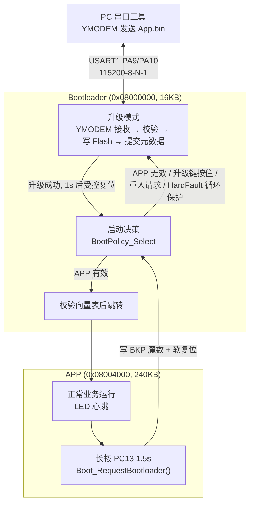

# STM32F411 YMODEM Bootloader

面向 STM32F411CEU6 的串口 Bootloader：通过 USART1 接收 YMODEM 固件，写入 APP 分区，
完成 CRC32 完整性验证并跳转运行。仓库同时提供一个 LED 闪烁演示 APP。

> A UART (YMODEM) bootloader for STM32F411CEU6 with power-fail-safe metadata commit
> and a demonstration application. Docs are in Chinese.

## 关键事实

| 项 | 配置 |
|---|---|
| MCU | STM32F411CEU6，512 KB Flash，128 KB SRAM |
| 时钟 | 12 MHz HSE → PLL(M=12, N=192, P=2) → 96 MHz |
| 串口 | USART1，PA9/PA10，115200-8-N-1 |
| 协议 | YMODEM CRC16，支持 128 B SOH 与 1 KB STX 数据包 |
| 分区 | BL 16 KB / APP 240 KB / Metadata 128 KB / Reserved 128 KB |
| Bootloader 体积 | 12480 B / 16384 B 上限（ARM Compiler 5 `-O0` 口径） |
| 构建 | Windows Keil MDK 或 VSCode + EIDE，均使用 ARM Compiler 5 |

## 架构



分层：`core`（启动编排）→ `app`（决策/升级编排）→ `protocols`（YMODEM）→
`drivers`（USART/Flash/CRC32）→ `modules`（board/LED/按键/SysTick/Boot API）。
协议层与策略层不含任何硬件头文件，便于移植和复用。

## 技术亮点

- **掉电安全**：元数据两阶段提交（内容先写、`magic` 最后写作为提交点），
  擦除前先使旧元数据失效。任何时刻断电，重启后要么运行旧固件，要么进入恢复模式，
  不会启动未验证的固件。
- **单上下文状态机**：SysTick 中断只累加 1 ms 节拍，协议状态机全部在主循环串行执行，
  避免中断与主循环并发读写协议状态。
- **协议健壮性**：8-bit 序号回绕（255→0）、1 s 帧内超时（半包滞留）、
  包内 `CAN CAN` 快速中止、重复包去重、最终 ACK 丢失重传兼容。
- **数据通路**：USART1 + DMA2_Stream2 循环缓冲，主循环轮询，溢出可检测。
- **启动安全**：三重校验（元数据 / 向量表 / 全固件 CRC32）+ 跨镜像 HardFault
  循环保护（RTC BKP4R 计数，BL 自身与 APP 经 `boot_api.h` 共同上报，APP 稳定运行后自清）。

## 目录

```text
BootLoader/
├── bootloader/              Bootloader 独立 Keil/EIDE 工程
│   ├── app/                 启动决策和升级流程
│   ├── config/              分区、超时和版本配置
│   ├── core/                main 和异常处理
│   ├── drivers/             USART DMA、Flash、CRC32
│   ├── protocols/ymodem/    平台无关 YMODEM 接收状态机
│   ├── modules/             board、LED、按键、SysTick、Boot API
│   └── libraries/           CMSIS 和 STM32 StdPeriph
├── app/                     演示 APP 独立 Keil/EIDE 工程
├── docs/                    构建、设计和升级文档
└── BootLoader.code-workspace
```

## 快速开始

1. 用 VSCode + EIDE 打开 `BootLoader.code-workspace`，或分别用 Keil 打开两个子工程的 `.uvprojx`。
2. 构建 `bootloader` 工程，通过 ST-Link 烧录 Bootloader。
3. 构建 `app` 工程，得到 `app/build/app/App.bin`。
4. 串口工具选择 115200-8-N-1 和 `Ymodem`，发送 `App.bin`。发送器可自动选择 128 B SOH 或 1 KB STX 数据包。
5. 升级成功后 Bootloader 校验、提交元数据，1 秒后受控复位并重新校验后启动 APP。

正常复位且 APP 有效时会立即跳转，不再开放固定的串口等待窗口。进入升级模式的三种方式：
上电/复位时按住 PC13 约 100 ms；APP 运行中长按 PC13 约 1.5 s（演示 APP 已内置，
LED 快闪提示后复位，业务固件可直接调用 `Boot_RequestBootloader()`）；
没有有效 APP 时自动进入恢复模式。

升级带防降级保护：APP 实际完好（元数据、向量表、CRC32 全部通过）时，文件名版本
（`vX.Y`）低于已装版本的固件会被拒绝；APP 损坏或文件名无版本号时不做限制，
保证旧版本可救砖。Bootloader 另有 HardFault 复位循环保护：Bootloader 自身与 APP 经
`boot_api.h` 的 `Boot_ReportFaultReset()` 上报的致命异常累计到 3 次时，不再自动跳 APP，
停在升级模式等待修复。计数只由升级成功和 APP 稳定运行后的 `Boot_ReportHealthy()` 清零，
崩溃循环的固件到不了上报点，因此计数能连续累积。

## 设计取舍与已知局限

- **单 Bank，无 A/B 双备份**：16 KB Bootloader 的刻意取舍；坏固件依靠三重校验与
  HardFault 循环保护拦截，回退需重新烧写。
- **CRC32 是完整性校验，不是签名/防篡改**：无密钥、无加密，不能当作安全启动。
- **防降级版本取自文件名**：改名会降级为"版本未知 → 放行"，不侵入 APP 链接脚本。
- **不使用 IWDG**：所有等待路径均有软件超时；看门狗运行时不可关闭，会把
  "必须持续喂狗"义务传染给 APP，破坏跳转契约（详见架构详解决策 #2）。

## 文档

- [开发与构建](docs/开发与构建.md)：EIDE、Keil、输出文件和配置同步
- [架构详解](docs/架构详解.md)：升级闭环全景图、分层架构图、启动决策与升级时序图、YMODEM/updater 状态机、掉电安全与 RX 数据通路图、设计决策
- [系统设计](docs/系统设计.md)：Flash 分区图、启动决策流程图、升级流程概要与跳转流程
- [升级与排错](docs/升级与排错.md)：YMODEM 操作、LED 状态和常见问题
- [CHANGELOG](CHANGELOG.md)：版本演进与显著变更
